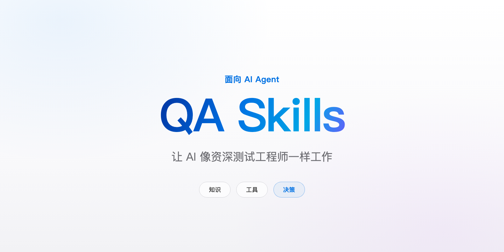

**English** | [简体中文](./README.md)

<p align="center">
  <picture>
    <source media="(prefers-color-scheme: dark)" srcset="./assets/hero-dark.png">
    
  </picture>
</p>

<h1 align="center">qa-skills</h1>

<p align="center"><strong>Make AI work like a senior QA engineer.</strong></p>

<p align="center">A QA engineering skill framework for AI coding agents.<br>From requirement clarification and risk decisions to executable cases, automation and reports.</p>

<p align="center">
  <a href="https://github.com/fishzjp/qa-skills/actions/workflows/ci.yml"></a>
  <a href="./skills/"></a>
  <a href="https://www.skills.sh/fishzjp/qa-skills"></a>
  <a href="https://github.com/fishzjp/qa-skills/releases"></a>
  <a href="https://github.com/fishzjp/qa-skills/blob/main/LICENSE"></a>
</p>

---

Install testing methods, workflows and output standards into your agent: **12 testing skills + the shared `core/` knowledge base**. Run the full pipeline or use a single stage for cases, reviews, API tests or flaky-test governance. Browse the [five real On/Off comparisons](./examples/) first to see the outputs.

[Quick start](#quick-start) · [Choose a skill](#choose-a-skill) · [How it works](#how-it-works) · [Compatibility and scope](#compatibility-and-scope) · [Measured results](#measured-results) · [Documentation](#documentation)

## Quick start

### 1. Install all skills

Install from GitHub through [skills.sh](https://skills.sh) (requires Node.js compatible with the skills CLI (Node.js 24 is tested) for `npx`; no npm login needed):

```bash
npx skills add fishzjp/qa-skills --skill '*'
```

Choose your host and installation scope when prompted. **Keep `--skill '*'`: `core/` is a required shared dependency, not a standalone task skill.** Installing a single skill without `core/` breaks relative references. Repair a partial installation by running the full command above.

<details>
<summary><strong>Other installation methods, upgrades and removal</strong></summary>

**Repository installer** (requires Git and Bash):

```bash
git clone https://github.com/fishzjp/qa-skills.git
cd qa-skills
./install.sh                 # choose a host directory interactively
```

If you know the destination, set it explicitly; the script creates it if needed:

```bash
./install.sh --target ~/.agents/skills
```

Confirm that your host reads this directory. `./install.sh --auto` selects the first **existing** candidate in this order: `~/.agents/skills`, `~/.claude/skills`, `~/.codex/skills`, `~/.dsh/skills`, then this repository's `.claude/skills`. It exits if none exists.

| Installation | Upgrade | Remove |
|------|------|------|
| skills.sh | Re-run the full installation command | Use skills.sh's removal flow and select the entries |
| `install.sh` copy | Run `git pull`, then repeat the original install command | `./uninstall.sh --target <original-directory>` |
| `install.sh --target <dir> --link` symlinks | `git pull` updates the content; keep the repository at its original path | Same as above; keep the source repository until removal |

For symlink installs, `qa-skills.VERSION` is an installation-time snapshot; `git pull` does not refresh it. Re-run the installer to update the marker.

**DeepSeek Harness (dsh)**: clone the repository, then install directly into its skills directory:

```bash
./install.sh --target ~/.dsh/skills
```

To upgrade, run `git pull` and repeat the command. Distribution through the npm plugin package has ended. Existing plugin users should remove the old plugin with the dsh plugin manager before installing this way to avoid duplicate loading.

**Manual copy**: copy every top-level directory under `skills/` into the host's skills directory, keeping each skill alongside `core/`. Check ownership before replacing existing directories. Manual copying does not create a version marker.

</details>

### Pin a version, upgrade or roll back

The default command follows the GitHub source; it does not pin the latest Release. Use a Git tag for repeatable installation (v0.9.0 below is a published historical version and excludes subsequent main-branch fixes):

```bash
git clone --branch v0.9.0 --depth 1 https://github.com/fishzjp/qa-skills.git qa-skills-stable
cd qa-skills-stable
./install.sh --target ~/.agents/skills
```

In a full clone, run `git fetch --tags`, then `git switch --detach <published-tag-or-full-commit>` and repeat the installer. Rollback uses the same process. Save local changes first and check the selected version's installer and ownership rules; older installers lack the new recovery behavior.

The current installer preflights every unit, stages content and restores the previous payload and marker on handled copy/replacement failures. **Switching multiple directories is not atomic as a group; pause host reads during installation.** Power loss or SIGKILL cannot trigger rollback. If `.qa-skills.lock` or `.qa-skills.txn.*` remains, first check whether its pid is running and preserve the transaction backups: see [recovery instructions](./RELEASING.md#安装失败恢复--installation-recovery). Existing project-owned directories are replaced in full; maintain customizations in a repository branch.

### 2. Check installation and loading
From a clone, verify the host's actual directory (also works for skills.sh installs):

```bash
python3 scripts/verify_install.py ~/.agents/skills
```

Run the verifier from the same tag/commit used for installation. It checks all expected units, helper files and core references; it invokes no model and does not establish host loading or output quality.


The destination should contain the directories in the [skill list](#choose-a-skill) plus `core/`, including `qa/SKILL.md` and `core/executability.md`. **Only the repository's `install.sh` writes `qa-skills.VERSION` (version, commit, installation method and source)**; its absence does not mean another installation method failed.

Refresh skills or start a new session as your host requires. Try: “Use test-strategy to plan testing for this requirement.” Check the host's loading trace for `test-strategy/SKILL.md` and the required `core/` files. If no trace is available, ask the agent to list the file paths it actually read. Files on disk alone do not establish that triggering works.

### 3. Provide input and start testing

Try the [room-booking walkthrough](./examples/first-task/README.en.md) first: no running service is needed, and it includes a brief, stage requests and a review checklist.

In the project under test, tell your agent:

```text
Test this requirement: coupons must close automatically at expiry.
Requirement: <replace with your PRD path>
Code: this repository; regression baseline: main
Start with requirement analysis and test strategy. List questions for my confirmation.
```

Inputs can be text, a PRD, API documentation or existing cases. Code adds implementation evidence; document-only work keeps unresolved items explicit. Execution also needs a reachable test environment, test accounts and tools: Playwright for Web E2E, Python / pytest and related tools for API tests, and k6 when load testing is needed. **Installing the skills does not install these tools or the application under test.**

The full workflow pauses for clarification, execution strategy, bug classification and budget decisions. For one stage only, use a request from the table below.

## Choose a skill

| Your request | Skill | Main output |
|------|------|------|
| “Test this feature fully” | [qa](./skills/qa/SKILL.md) | Stage orchestration, pipeline state and final report |
| “Understand this requirement; ask about ambiguities” | [requirement-analysis](./skills/requirement-analysis/SKILL.md) | Requirement model, scope and clarification record |
| “Decide what to test and what to exclude” | [test-strategy](./skills/test-strategy/SKILL.md) | Risk map, ten-type `type_scope`, specialist handoffs |
| “Write cases from this PRD / code” | [test-case-writing](./skills/test-case-writing/SKILL.md) | markmap cases + machine-readable Schema |
| “Review these existing cases” | [test-case-review](./skills/test-case-review/SKILL.md) | Coverage and executability review, revisions and record |
| “Convert cases to Web automation and run them” | [automated-e2e-testing](./skills/automated-e2e-testing/SKILL.md) | Playwright project, results and defect evidence |
| “Test these APIs from OpenAPI” | [api-testing](./skills/api-testing/SKILL.md) | API test scripts and results; k6 handoff when needed |
| “Explore this system with incomplete docs” | [exploratory-testing](./skills/exploratory-testing/SKILL.md) | Charter, exploration notes, risks and test ideas |
| “Find the root cause of this confirmed bug” | [bug-analysis](./skills/bug-analysis/SKILL.md) | Root cause, impact, evidence and regression advice |
| “Which cases should we rerun after this change?” | [regression-testing](./skills/regression-testing/SKILL.md) | Ranked diff → feature → case regression list |
| “Tests pass on retry; can we trust them?” | [test-reliability](./skills/test-reliability/SKILL.md) | Flaky evidence, quarantine / retry policy, suite health |
| “Save / read this project's testing knowledge” | [qa-memory](./skills/qa-memory/SKILL.md) | Project `.qa/` knowledge base, index and validation |

`core/` provides shared methods, templates and scripts. Its full index is [core/SKILL.md](./skills/core/SKILL.md); do not invoke it as a task skill.

## How it works

**Stages save outputs to files and pass those files forward.** To resume an interrupted pipeline, give `qa` the output directory in a new session; it checks stage-completion criteria before continuing.

```text
PRD / code ── (explore first if documentation is insufficient)
   ↓ requirement-analysis
需求模型.md                         ⏸ clarification
   ↓ test-strategy
测试策略.md + type_scope            ⏸ budget, when a decision is required
   ↓ test-case-writing → test-case-review
测试用例_markmap.md + schema.yaml   ⏸ execution strategy
   ↓ Playwright / API / manual execution
Execution records + defect evidence ⏸ bug classification
   ↓ bug-analysis / regression-testing (as needed)
Bug entries / regression list → report
```

- **Executable cases**: explicit preconditions, entry points, steps, testable outcomes and time limits for asynchronous behavior. See [executability.md](./skills/core/executability.md) and the [complete case example](./examples/test-cases_with-skills.md).
- **Evidence-backed scope**: evidence levels E0–E4, justified risk ratings, and explicit inclusion, depth or exclusion decisions for all ten test types, recorded in a validated `type_scope`.
- **On-demand loading**: SKILL.md holds trigger boundaries and workflows; `core/` and `references/` hold methods and templates. Hosts with sub-sessions isolate stages; others use sequential sessions and files. Instruction-following quality still needs validation on each host.
- **Cross-session knowledge**: stage state stays in output files; `qa-memory` manages reusable project knowledge separately.

<details>
<summary><strong>Render case mind maps and load project knowledge</strong></summary>

**Mind maps**: preview `测试用例_markmap.md` with the [VS Code Markmap extension](https://marketplace.visualstudio.com/items?itemName=gera2ld.markmap-vscode), or generate HTML with `npx markmap-cli 测试用例_markmap.md`.

**Project knowledge**: `qa-memory` maintains `.qa/INDEX.md` and topic entries inside the project under test and reads them when triggered. To make the index discoverable in later sessions, add an entry to the host's project instructions:

| Supported host entry point | Configuration |
|------|------|
| `AGENTS.md` | State: “Before testing, read `.qa/INDEX.md`, then read relevant entries as needed.” |
| Claude Code's `CLAUDE.md` | Add `@.qa/INDEX.md`, or load it through an existing `@AGENTS.md` import chain |
| Aider | Set `read: .qa/INDEX.md` in `.aider.conf.yml`, or start with `--read` |
| Other hosts | Configure their project-instruction mechanism, or let the skill read it when triggered |

Discovery and reading depend on host behavior; a Markdown link alone does not ensure its target is loaded. Bootstrap shows proposed changes and asks for confirmation before writing; knowledge entries follow the results of [memory_validate.py](./skills/qa-memory/scripts/memory_validate.py).

</details>

## Compatibility and scope

The product ships Markdown instructions, relative references and helper scripts run as needed. The installer supports Bash 3.2+; public scripts support Python 3.9–3.14. The CI matrix covers Linux on 3.9/3.12/3.14 and macOS on 3.12. Native Windows is not covered; use WSL and verify host paths separately. Hosts must support skill discovery and file reading; execution also needs terminal or browser tools.

| Host / method | Directory or package | Existing validation scope |
|------|------|------|
| Claude Code | `~/.claude/skills/` or project `.claude/skills/` | Primary target; installation records available |
| Shared directory | `~/.agents/skills/` | First installer candidate; reading depends on the host |
| DeepSeek Harness (dsh) | `~/.agents/skills/` or `~/.dsh/skills/` | End-to-end validation recorded |
| Codex | skills.sh was verified at `~/.agents/skills/`; the repository installer also accepts `~/.codex/skills/` | Installation and reference paths checked; output gains not systematically evaluated |
| Other Agent Skills hosts | Follow their installation rules | Structurally adaptable; triggering, loading and quality need separate checks |

See the [RELEASING installation matrix](./RELEASING.md#安装形态实测矩阵触达安装面引用路径的发版必登记) for dates and commands. **Installation, correct triggering and output quality are distinct checks.**

**Language**: the README and website are bilingual. Of the 12 skills, 11 have bilingual descriptions; `bug-analysis` retains its Chinese description to avoid an observed routing regression. Skill instruction bodies remain Chinese.

**Scope**: system-level black-box test decisions and execution. Unit / integration tests, real-device mobile automation, frontend component tests, specialist pentesting / SAST / dependency scanners and chaos-engineering toolchains are not provided. They may supply risk signals or receive handoffs; a handoff does not mean a test has been executed.

## Measured results

These are **historical experiment results**, not a fresh evaluation of this checkout or a guarantee for every model and host. The figures come from an early 12-task injected On/Off evaluation and later execution-specific checks, as detailed below. Each comparison uses the same model and harness within its On/Off pair. Judge-based metrics use a different model family from the generator. Rounds differ in sample size and task scope; do not combine them.

For version-specific evidence, see the [milestone Release snapshots](https://github.com/fishzjp/qa-skills/releases); the [CHANGELOG](./CHANGELOG.md) records later changes and corrections. [Examples](./examples/) show individual outputs. The harness, task pool and raw data are maintained locally and are not included in this repository.

<details>
<summary><strong>Historical metrics, costs and limitations</strong></summary>

| Metric | Without | With |
|--------|:---:|:---:|
| Case-conformance score | 0.26 | **0.98** |
| E2E real execution (single task × 3 samples) | 0/3 runnable | 1 full + 2×(2/3) |
| Planted-bug detection | — | **75%** |
| Quality (LLM judge) | 0.70 | **0.76** |
| API real-execution pass rate † | 100% | 99.2% |
| Token cost | 1× | 3.3× |

> **Test-type decision matrix, first round (2026-08-23, not yet in the formal gain table)** — 5 test-type decision tasks (reference answers dual-annotated), weakest model deepseek-v4-flash (n=3): without the skill, **zero explicit type decisions** (0 even under lenient parsing — the blind spot is decision discipline, not type knowledge); with the skill, type recall **0 → 0.88**, and code-signal-only axes absent from the PRD 0 → 8/9. Both numbers enter the formal table after task-pool growth and cross-model rounds.

<details>
<summary><strong>Metric definitions and limitations</strong></summary>

- **Case-conformance score**: format × content-rubric composite, no judge; format-free samples score 0 (same caliber), the gap is driven primarily by format adoption; replicated across two generator models (0.20→0.99); the earlier 0.77 was pre-fix — errata in the [CHANGELOG](./CHANGELOG.md).
- **E2E real execution**: real browser + real app, no judge; the without-skill group mixes no-code and failing-code outcomes.
- **Planted-bug detection**: heterogeneous-judge caliber (100% under same-family judge).
- **Quality**: heterogeneous judge; Δ +6.1pp (95%CI includes zero; significant under same-family judging).
- **API real-execution pass rate †**: clean re-verification caliber (main model glm-5.2, n=3): 100% without vs 99.2% with — within the noise band, at parity; the weak-model round favored the skill (0.30 without / 0.67 with); it is a separate result. The earlier adverse result was traced failure-by-failure to evaluation-side defects, not skill defects — errata in the [CHANGELOG](./CHANGELOG.md).
- **Token cost**: higher instruction and workflow cost — total-token ratio (per-task mean, skill fully injected): 3.3× on the main-model round, up to 9.5× on the weak-model round; a single-file ablation shows the gains cannot be obtained by taking just the core standards document.
</details>

<details>
<summary><strong>Pre-registered gates & coverage gains</strong></summary>

Pre-registered gates: 4/7 under the same-family judge, 5/8 under the heterogeneous judge (different compositions incl. a sign flip). Coverage gains (heterogeneous judge): **+8.7pp** case-writing tasks (CI [0.5, 15.4]), **+13.2pp** all tasks (CI [2.8, 26.3]), **+9.7pp** defect detection (CI [3.3, 16.4]) — all significant; same-family figure +3.8pp (judge leniency quantified and corrected — see the [CHANGELOG](./CHANGELOG.md)). An early +29pp single-sample estimate was shown to be noise.

**Validity boundary**: evaluation pre-injects all skill instruction files; real hosts load on demand. These results do not establish gains across all hosts or models. An in-situ probe (n=1) observed no decay, but is too small to establish equivalence; pairwise judging exceeded tie limits under all three judges (win rate voided — mechanism issue).
</details>

</details>

## Documentation

| Document | Read it to… |
|------|------|
| [First task](./examples/first-task/README.en.md) | Try a brief-to-cases exercise without accounts |
| [Support](./.github/SUPPORT.md) | Find reporting routes, required context and support limits |
| [examples/](./examples/) | Compare five On/Off output pairs and understand selection / interpretation (Chinese) |
| [core/SKILL.md](./skills/core/SKILL.md) | Find shared methods, standards, templates and helpers (Chinese) |
| [CHANGELOG.md](./CHANGELOG.md) | Check version changes, historical results and corrections (Chinese) |
| [Releases](https://github.com/fishzjp/qa-skills/releases) | Find milestone gain-matrix snapshots |
| [Contributing](./CONTRIBUTING.en.md) | Contribute, understand constraints and run public checks |
| [RELEASING.md](./RELEASING.md) | Release, validate installations and synchronize distribution (Chinese) |
| [llms.txt](./llms.txt) | Retrieve a concise product summary for agents |

<details>
<summary><strong>Repository layout</strong></summary>

```text
skills/       Product: each skill's SKILL.md, references/, templates/, scripts/
  core/       Shared knowledge base; file index in core/SKILL.md
examples/     Real On/Off outputs and interpretation guide
scripts/      Architecture and repository validators
tests/        Product / gate regression tests and installer smoke checks
.dsh/         Legacy dsh plugin compatibility code and configuration
assets/       README / social images and landing-page fonts
install.sh    Repository installer (copy or symlink)
uninstall.sh  Corresponding uninstaller
index.html    Landing-page source
llms.txt      Machine-readable product summary
```

Design, planning and evaluation resources (`docs/`, `eval/`, etc.) are maintained locally and are not distributed with the public repository.

</details>

## Contribute and get help

Use the [contribution guide](./CONTRIBUTING.en.md) for improvements, [Discussions](https://github.com/fishzjp/qa-skills/discussions) for questions and experience, and [Issues](https://github.com/fishzjp/qa-skills/issues) for reproducible bugs and concrete requests. Report vulnerabilities privately under the [security policy](./.github/SECURITY.md).

[Code of Conduct](./.github/CODE_OF_CONDUCT.md) · [MIT license](./LICENSE)
